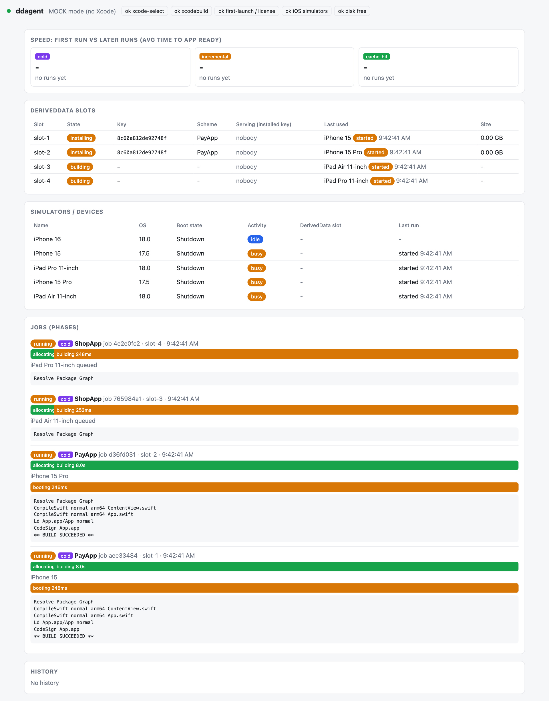
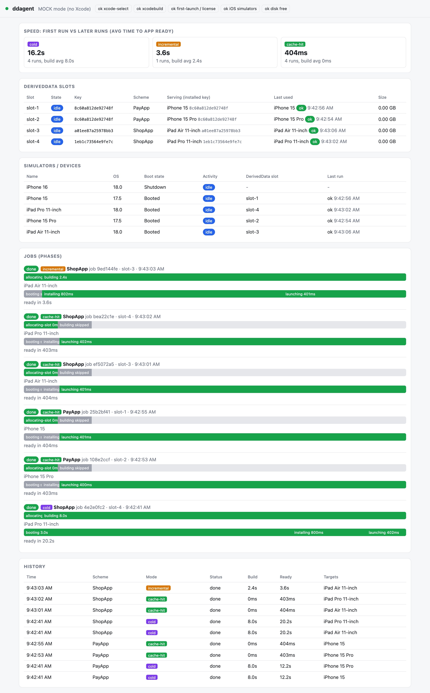

# ddagent

A local daemon, CLI and web dashboard that lets **several coding agents (and humans) build and run an iOS/iPadOS app on the same Mac without stepping on each other**.

It solves three problems that appear as soon as more than one agent works on an Xcode project:

1. **Slow builds.** Every agent or git worktree starts with an empty DerivedData, so every run is a cold build. ddagent keeps a small pool of DerivedData *slots* and reuses them, so repeat runs are incremental or skipped entirely.
2. **Simulator collisions.** Two agents installing onto the same simulator break each other's runs. ddagent hands out *lanes*: one agent holds one existing simulator exclusively until it releases it.
3. **No visibility.** A live dashboard shows slots, simulators, jobs and timings so you can see what every agent is doing.


*Four agents building at once: each holds its own lane (simulator) and DerivedData slot, with a live phase timeline and build log per job.*


*After the runs: cold, incremental and cache-hit timings, which slot serves which simulator, and the run history.*

> The screenshots were captured with Playwright against the daemon in mock mode (fake simulators, no Xcode).

> Status: iOS/iPadOS simulators only. Physical devices and Android are not supported yet.

Zero dependencies: Node.js built-ins only.

## Requirements

- macOS with full Xcode (not just Command Line Tools) and at least one available iOS simulator runtime. Use iOS 17.5+ if older runtimes are unreliable on your machine.
- Node.js 18.15 or newer (`fs.statfsSync` is used for the disk check).
- `git`, and access to GitHub if the repository is private (SSH key or token).

No Xcode? Run everything in mock mode (`--mock` or `DDAGENT_MOCK=1`) to try the workflow with fake simulators.

## Install

```
npm i -g github:cuongtq4998/ddagent      # install; the same command updates it
```

Make sure `$(npm prefix -g)/bin` is on your `PATH`, then check the setup:

```
ddagent doctor            # checks xcode-select, xcodebuild, first-launch/license, simulators, free disk
```

If `doctor` reports that Xcode is missing, either run `sudo xcode-select -s /Applications/Xcode.app` once, or prefix commands with `DEVELOPER_DIR=/Applications/Xcode.app/Contents/Developer` (no sudo).

Install once per machine: there is one daemon per user, shared by every repository on the Mac.

### Add it to a repository (for Claude Code agents)

```
cd your-repo
ddagent init              # add --force to overwrite existing skills
```

`init` copies the `ddagent-lane` and `ddagent-debug` skills into `.claude/skills/` and merges `Bash(ddagent ...)` permissions into `.claude/settings.json`. It never removes existing settings. Commit the result so every agent in the repo picks it up.

## Quick start

```
ddagent run --project /abs/path/App.xcodeproj --scheme App --target "iPhone 16"   # first run: cold build
ddagent run --project /abs/path/App.xcodeproj --scheme App --target "iPhone 16"   # same code: cache-hit
ddagent prewarm --project /abs/path/App.xcodeproj --scheme App --target "iPhone 16"   # build + boot + install, no launch
ddagent status
ddagent dashboard                                                                   # prints the dashboard URL
```

The daemon starts automatically on the first command. `--project` must be an absolute path to an `.xcodeproj` or `.xcworkspace`. `--target` takes a simulator name, a partial name or a UDID, and can be repeated.

## Using it from several agents (lanes)

```
LANE=$(ddagent lane acquire --owner agent-1)          # waits (FIFO) while every lane is busy; prints the lane id
ddagent run --lane $LANE --project /abs/path/App.xcodeproj --scheme App   # repeat after each code change
ddagent lane release $LANE                            # always release, even on failure
ddagent lane list
```

- A lane is one **existing** simulator. ddagent never creates simulators.
- At most `DDAGENT_MAX_LANES` (4) lanes exist; extra requests queue. An abandoned lane is released after `DDAGENT_LANE_TTL_MIN` (30) minutes, never while a job is running.
- Use the same `--owner` for the same agent: it gets the same lane or simulator back, and its next `run` reuses the same DerivedData.
- `lane acquire --target "iPhone 17"` asks for a specific device.

## Commands

| Command | Purpose |
|---|---|
| `ddagent run` / `prewarm` | Build (if needed), boot, install and launch (`prewarm` skips launch) |
| `ddagent lane acquire` / `release` / `list` | Exclusive simulator per agent |
| `ddagent status` | Slots and simulators in the terminal |
| `ddagent dashboard` | Print the dashboard URL (includes the access token) |
| `ddagent doctor` | Environment checks |
| `ddagent init [dir]` | Install skills and permissions into a repository |
| `ddagent start [--mock]` | Run the daemon in the foreground |

Useful flags: `--rebuild` (wipe the slot first), `--config Debug`, `--no-open`, `--mock`.

## How it works

```
ddagent CLI --HTTP--> daemon (server.js)
                        |- Runner       job = allocate slot -> build -> per target: boot -> install -> launch
                        |- Pool         DerivedData slots, build leases, bindings, disk floor
                        |- Lanes        exclusive simulator per agent, FIFO queue, idle expiry
                        |- Fingerprint  cache key from build context + file contents
                        |- Backend      real (xcodebuild/xcrun) or mock
                        '- Store        state.json (only the daemon writes it)
dashboard (browser) <--SSE-- daemon
```

**Build modes.** The cache key is a hash of the project, scheme, configuration, SDK, architecture, Xcode build and SDK versions, plus the contents of every build-relevant file (sources, xcconfig, plist, entitlements, assets, `Package.resolved`, ...).

| Mode | When | Effect |
|---|---|---|
| `cold` | The slot is empty | Full build |
| `incremental` | Same build context, changed sources | `xcodebuild` reuses the slot's intermediates |
| `cache-hit` | Key matches and the product exists | Build skipped, only install/launch |

**Slots and bindings.** A *slot* is one DerivedData directory. A *build lease* is held only while `xcodebuild` runs. A *binding* records which simulator has a slot's product installed, so an unchanged app is not reinstalled. The number of slots is capped by `DDAGENT_MAX_SLOTS`, and no new slot is created when free disk is below `DDAGENT_MIN_FREE_GB`. A slot left behind by a failed build is marked `dirty` and wiped before reuse.

**Parallelism.** Cold builds, simulator boots and package resolution are bounded by semaphores, and the same simulator is never used by two jobs at once.

## Dashboard

Open the URL printed by `ddagent dashboard`. The first `run` or `lane acquire` opens it automatically once; later agents see it already open (disable with `DDAGENT_NO_OPEN=1` or `--no-open`).

The page is served by the daemon on `127.0.0.1` and updates live over a server-sent-events stream (the dot next to the title is green while connected). Sections:

| Section | What it shows |
|---|---|
| Header | Mock-mode indicator and the `doctor` check results |
| Speed | Average time-to-ready and build time for cold, incremental and cache-hit runs |
| DerivedData slots | State (`idle`, `building`, `installing`), cache key, scheme, which simulators it serves (`stale` means the installed key is older than the slot's key), last use, size |
| Simulators / devices | Name, OS, boot state, busy/idle, bound slot, last run |
| Jobs | Phase timeline per job and per target (allocating-slot, building, booting, installing, launching; skipped phases are greyed), live build log |
| History | The last runs with mode, status, build and ready times |

Access is protected by a random token stored in `~/.ddagent/token` (mode 0600) and sent with every request. The server also rejects requests whose `Host` or `Origin` is not the local address and sends no CORS headers.

## Configuration

State lives in `~/.ddagent` (override with `DDAGENT_HOME`).

| Variable | Default | Meaning |
|---|---|---|
| `DDAGENT_PORT` | 7777 | Daemon port |
| `DDAGENT_MAX_LANES` | 4 | Maximum concurrent lanes |
| `DDAGENT_MAX_SLOTS` | = max lanes | Maximum DerivedData slots |
| `DDAGENT_MIN_FREE_GB` | 5 | Below this, no new slot is created and the job fails fast |
| `DDAGENT_LANE_TTL_MIN` | 30 | Idle lane expiry in minutes |
| `DDAGENT_NO_OPEN` | unset | Do not auto-open the dashboard |
| `DDAGENT_MOCK` | unset | `1` = fake simulators and builds, no Xcode needed |
| `DDAGENT_SKIP_PLUGIN_VALIDATION` | unset | `1` = pass `-skipPackagePluginValidation` to `xcodebuild` (needed for packages with build-tool plugins, e.g. Pillarbox) |
| `DDAGENT_MOCK_SPEED` | 1 | Scale mock delays |

## For agents

Read the skills installed by `ddagent init`:

- `ddagent-lane`: acquire a lane, run, release. Always release.
- `ddagent-debug`: wrong cache-hit/incremental, stuck slots, boot/install failures, odd `state.json`.

Rules of thumb: reuse the same `--owner`; never create simulators yourself; if a stale daemon holds the port, check `curl localhost:7777/api/ping`.

## Troubleshooting

- `doctor` fails on `xcode-select`: point it at a full Xcode (see Install).
- "not enough free disk": free space or lower `DDAGENT_MIN_FREE_GB`.
- All lanes busy: wait, or run `ddagent lane list` to see who holds them.
- Wrong cache result: a build-relevant file type may be missing from `EXT` in `lib/fingerprint.js`.
- Unknown state: inspect `~/.ddagent/state.json`.

## Development

```
npm test                       # node --test test/ddagent.test.js
DDAGENT_MOCK=1 node server.js  # run the daemon directly in mock mode
```

Constraints: Node built-ins only (CommonJS, `'use strict'`); every backend operation exists in both `realBackend` and `mockBackend`; only the daemon writes `state.json`; develop and test in mock mode. See `CLAUDE.md`.
